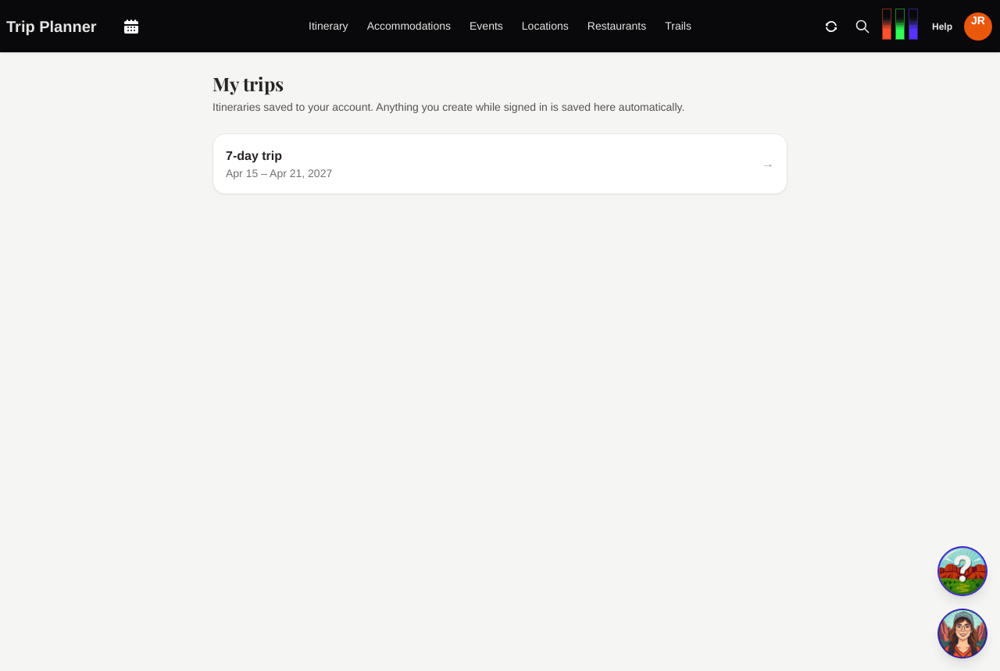

Select your initials in the top-right corner and choose **My trips**.

The page lists every itinerary saved to your account, most recently saved first, with its name and dates. Select one to open it. You can edit any trip on this list from any device where you're signed in.

## What appears here

- Trips you created while signed in.
- Trips you created before signing in and then saved with **Save to my account**.

Trips you only made in a browser, without saving them, don't appear. Open them in that browser and choose **Save to my account** to add them.

## Nothing listed?

- **"Sign in to see the trips saved to your account."** You're signed out. Choose **Sign in**.
- **"No saved trips yet."** Choose **Plan a trip** to start one, or save an existing trip from the browser you made it in.
