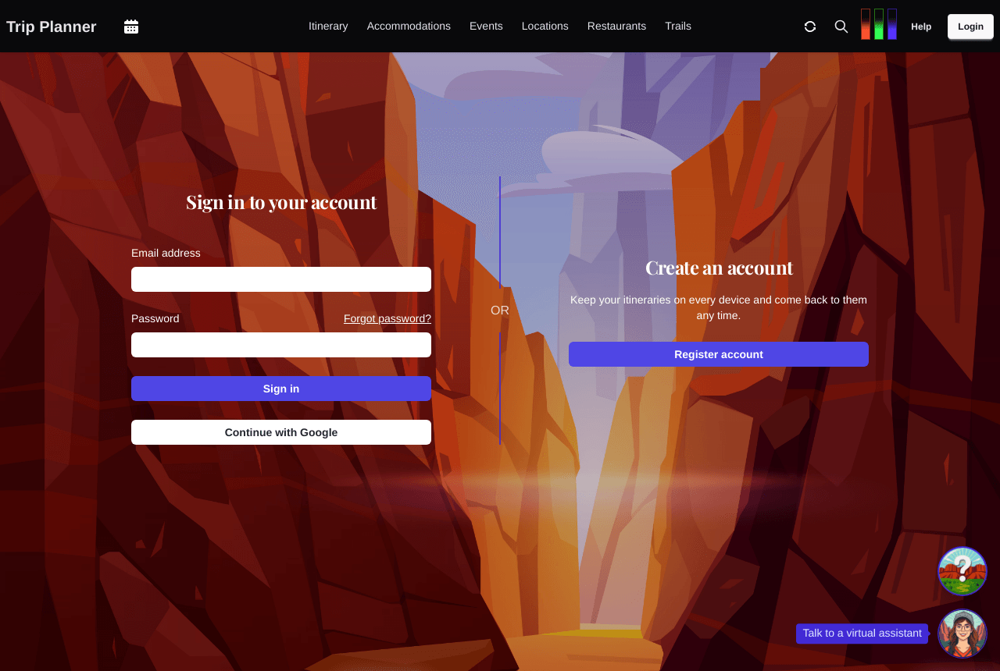
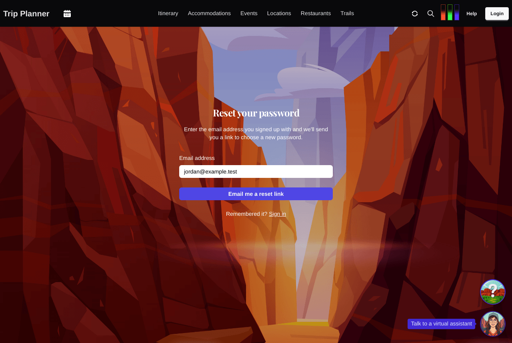

You can plan, edit and share trips without an account. An account lets you keep your trips on every device and find them all in one place.

## Create an account

1. Choose **Login** in the top-right corner.
2. Under **Create an account**, choose **Register account**.
3. Enter your name, email address and a password (at least 8 characters), and confirm the password.
4. Choose **Create account**.

You're signed in straight away, and your initials appear in the top-right corner.

## Sign in with Google

On the sign-in page, choose **Continue with Google** and pick your Google account. The first time, this creates a Trip Planner account using your Google name and email. You don't need a separate password.

If you already registered with the same email address, signing in with Google uses that same account.

## Sign in with email

Choose **Login**, enter your email address and password, and choose **Sign in**.

## Forgot your password?

1. On the sign-in page, choose **Forgot password?** next to the password box.
2. Enter the email address you signed up with and choose **Email me a reset link**.
3. Open the email, **Reset your Trip Planner password**, and choose **Choose a new password**.
4. Enter a new password twice and choose **Save new password**.
5. Sign in with your new password.

The link works for 60 minutes and only once. If it has expired, the page offers to send a new one. To protect your privacy, the page always says a link has been sent, whether or not that email address has an account. If nothing arrives within a few minutes, check your spam folder, and check you used the address you signed up with. You can ask for a new link once a minute.

If you signed up with Google, you don't need a password. You can still use **Forgot password?** to add one, so you can also sign in with your email address.

## Sign out

Select your initials in the top-right corner and choose **Sign out**.

Signing out doesn't delete anything. Trips saved to your account are there when you sign back in. Trips you made in this browser without saving them stay editable in this browser.

## Trips you made before signing in

Signing in doesn't automatically move trips you made beforehand into your account. Open the trip in the browser you made it in and choose **Save to my account** in the trip summary. See [Sharing and who can edit](/docs/itinerary/sharing/#its-saved-to-your-account).
