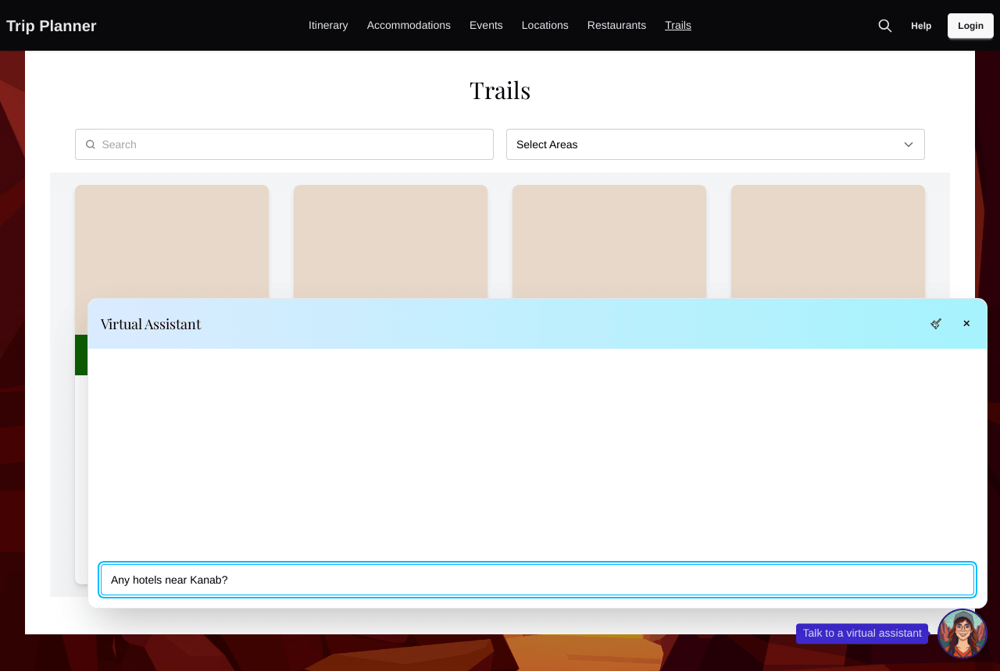

The virtual assistant answers questions about the area in plain language.

## Open it

- On a computer, select the round **assistant** button in the bottom-right corner. Select it again, or the **×**, to close.
- On a phone, choose **Assistant** in the bar at the bottom of the screen.
- Choose **Ask question** on any trail or restaurant to open the assistant about that place.

Type your question and press **Enter**.

## What you can ask

- **About a trail or restaurant**: "How long does Observation Point take?", "Is this trail good for kids?", "Do they have vegetarian options?" Mention the place by name, or open the assistant from that place's **Ask question** button.
- **For a trail map**: ask about a trail and include the word "map", for example "Show me a map of Hop Valley".
- **About places to stay**: mention a hotel, motel, Airbnb, VRBO or accommodation.
- **For a new itinerary**: ask it to create, build, make or revise an itinerary, and say what you'd like to change, for example:
  - "Make me an itinerary with easier hikes", or "shorter", "gentler".
  - "Create an itinerary with harder, longer hikes", or "more challenging".
  - "Build an itinerary with fewer crowds", or "quieter", "secluded".
  - "Revise my itinerary to stay closer", or "less driving".
  - "Make an itinerary that's more adventurous", or "off the beaten path".

  The assistant confirms first, then builds a new trip from your current one's dates and preferences, nudged in the direction you asked.

## Conversations

The assistant keeps separate conversations for general questions, restaurants and trails. In its header, **Show chat history** (the clock) switches between them, and **Clear chat history** (the broom) starts the current one afresh.

:::note
The assistant is AI-powered and uses Trip Planner's information about each place. Its answers can be incomplete, out of date or wrong. Double-check anything safety-related, like closures, permits and water sources, with the park or land manager.
:::
