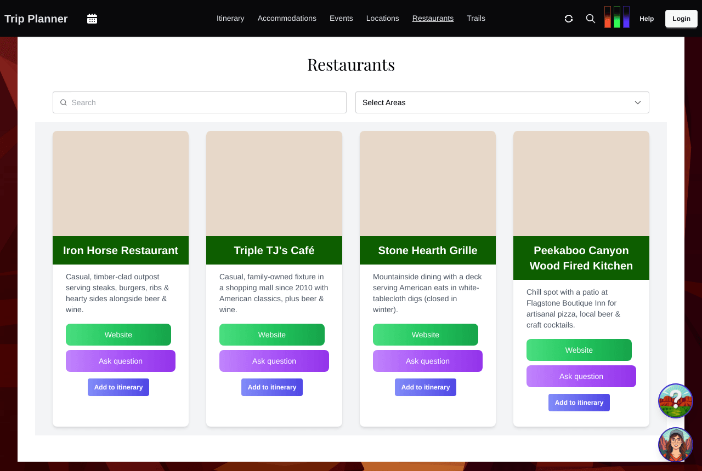

The header links (or the ☰ menu on a phone) open a page for each kind of thing Trip Planner knows about. Every page has a search box and a **Select Areas** filter.

## Restaurants

Featured restaurants appear when the search box is empty. Each shows a description and buttons:

- **Website** opens the restaurant's own site, when it has one, in a new tab.
- **Ask question** opens the [virtual assistant](/docs/explore/assistant/) about this restaurant.
- **Add to itinerary** adds it to a day of your trip, at noon. Change the time afterwards if you're going for breakfast or dinner.

On your itinerary, a restaurant meal shows the typical price per person. Trip Planner only schedules restaurants during their opening hours.

## Events

Featured upcoming events appear when the search box is empty. Search results show each event's date and area. Expand an event and choose **Add to itinerary** to put it on a day (at 6:00 PM, so adjust the time to match the event).

When Trip Planner builds a trip it adds events happening on your days, if you chose event activities and your adventurousness is at least halfway. An event on your wish list moves a day in its area to the date it happens.

## Locations

Places to see: viewpoints, museums, visitor centres, landmarks and more. Type in the search box to find them, then expand a result and choose **Add to itinerary**. A place on your wish list gets about 90 minutes on a day in its area.

## Accommodations

Places to stay around the region. Type in the search box to find them. Your itinerary's check-in item links to your lodging with **View accommodations**.

## Adding to your trip

**Add to itinerary** works the same way everywhere:

- If you have a trip you can edit, pick the day to add it to. Days in the same area are marked **nearby**, and the button changes to **Added to Day 3** (for example).
- If you don't, it's added to your wish list as **Saved for your next itinerary**, and Trip Planner fits it in when you create one.
- While you're [swapping an item](/docs/itinerary/editing/#swap-an-item-for-something-similar), the button reads **Use this instead**.
