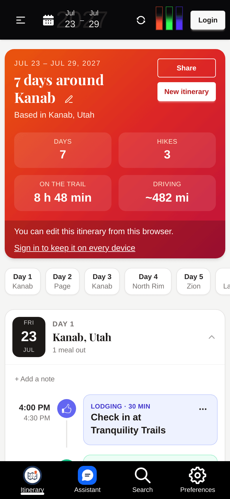

## On a computer

The black bar along the top is always there.

| Item | What it does |
| --- | --- |
| **Trip Planner** | The app's name. |
| Calendar icon and dates | Shows your trip dates while an itinerary is open. Select the calendar to pick different dates, then select the circular arrows to rebuild the trip for them. |
| **Itinerary** | Opens your current itinerary, or builds one if you don't have one yet. |
| **Accommodations**, **Events**, **Locations**, **Restaurants**, **Trails** | Browse everything Trip Planner knows about in the area. See [Exploring the area](/docs/explore/trails/). |
| Circular arrows | Builds a brand-new itinerary from your current answers. |
| Magnifying glass | Opens search across trails, restaurants, events and places. |
| Three coloured bars | Your adventurousness, solitude and effort settings at a glance. Select them to change your answers. |
| **Help** | Opens this guide. |
| **Login** or your initials | Sign in, or open your account menu with **My trips** and **Sign out**. |

Two round buttons float in the bottom-right corner:

- The **questionnaire** button (a canyon landscape) takes you back to the questionnaire.
- The **assistant** button (a smiling guide) opens the [virtual assistant](/docs/explore/assistant/).

## On a phone

The header shrinks to the menu button, your trip dates, the circular arrows, the three coloured bars and the account button. The browse pages move into the menu (☰).

A bar along the bottom holds the four things you'll use most:

- **Itinerary**: your plan.
- **Assistant**: the virtual assistant.
- **Search**: find trails, restaurants, events and places.
- **Preferences**: the questionnaire.

