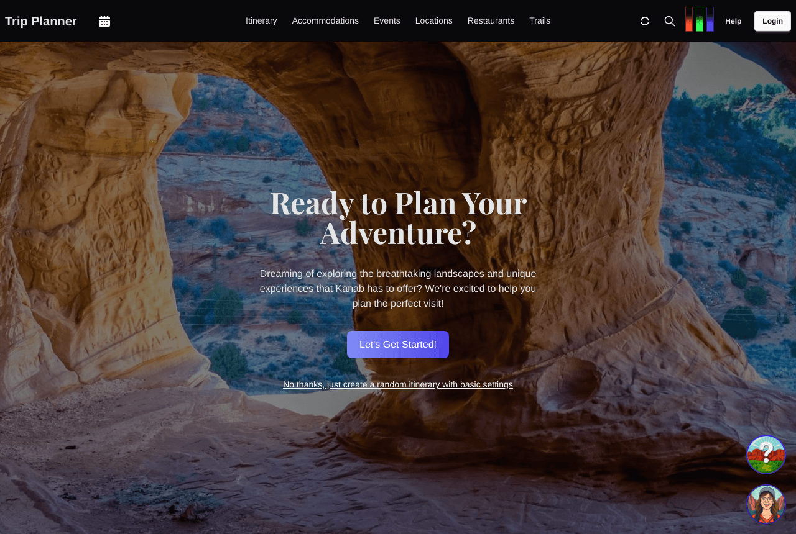
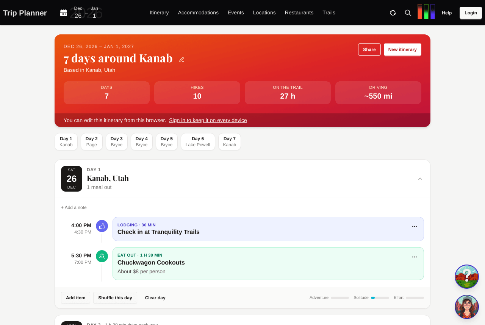

You don't need an account to plan a trip. Here's the fastest way to a plan you can use.

## 1. Start the questionnaire

Open Trip Planner and choose **Let's Get Started!** You can also reach the questionnaire at any time from the round **questionnaire** button in the bottom-right corner, or **Preferences** on a phone.

In a hurry? Choose **No thanks, just create a random itinerary with basic settings** to get a seven-day plan with middle-of-the-road settings. You can fine-tune it afterwards.

## 2. Answer five short steps

1. **Dates:** pick your arrival and departure days, or tick **I don't have specific dates** and choose the months you'd consider.
2. **Activities:** tick what you enjoy. If you choose hiking, tell us roughly how many minutes a mile takes you.
3. **About You:** set three sliders for adventurousness, solitude and effort.
4. **Destinations:** add any trails or events you already know you want.
5. **Itinerary:** choose **Create itinerary**.

Each step is described in detail in [The trip questionnaire](/docs/planning/questionnaire/).

## 3. Read your plan

Your itinerary opens with a summary at the top and one card per day below it. Use the day buttons under the summary to jump to any day.

See [Reading your itinerary](/docs/itinerary/reading/) for what everything means.

## 4. Make it yours

Every item has a **⋯** menu for changing its time, swapping it for something similar or removing it. Every day has **Add item**, **Shuffle this day** and **Clear day**. See [Editing a day](/docs/itinerary/editing/).

## 5. Keep it

Your plan is saved automatically, and this browser remembers that it's yours. To keep it on every device, [create an account](/docs/accounts/sign-in/) and choose **Save to my account**. To show it to someone, choose **Share** and send them the link.

:::tip
Not happy with the whole plan? Choose **New itinerary** in the summary for a fresh one built from the same answers.
:::
