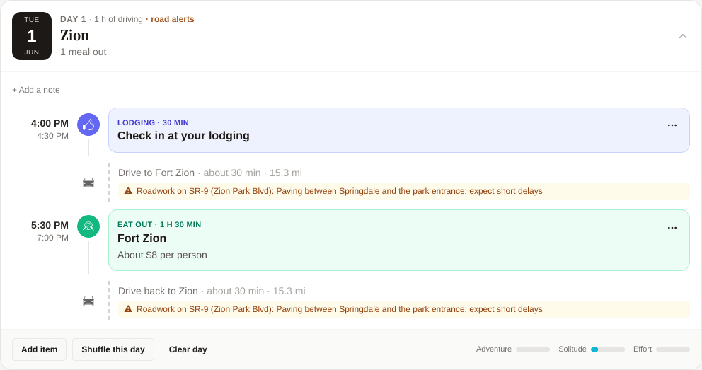

Southern Utah's sights are spread out, so a lot of each day is spent driving. Trip Planner puts every drive on your timeline, so you can see what a day really involves.

## Reading a drive

Each drive shows where it goes, how long it takes and how far it is, for example **Drive to Angels Landing · 52 min · 41.2 mi**.

- Drive times are worked out along the actual roads, from OpenStreetMap, to the trailhead, restaurant or place itself.
- **"about"** means the time is an estimate from the straight-line distance, because the route couldn't be worked out from the road map for that drive (a trailhead down a track that isn't mapped, for example). Allow some extra time.
- The **day heading** shows the day's total driving.
- Stops right next to each other, like a café by the trailhead, have no drive between them.

Times are for normal driving. They don't include stops for fuel, photos or food, and there's no live traffic data for these roads, so allow extra time on busy weekends and holidays, especially at park entrances.

## Road alerts

Trip Planner checks the Utah (UDOT) and Arizona (AZ511) road reports for each drive, for the day you're driving it.

| Alert | What it means | What Trip Planner does |
| --- | --- | --- |
| ⚠ **Roadwork**, **Lane closure**, **Incident** | Something on your route may slow you down. | Adds 10–15 minutes to the drive. |
| ⛔ **Detour around a closure** | A road on the usual route is closed that day. | Plans the drive around it. The time shown is the detour. |
| ⛔ **Road closed**, no way around | The road is closed and there's no other way. | Keeps the usual time and warns you. Check conditions before you go. |
| ⚠ **You may arrive late** | There isn't enough time to drive between two stops. | Shown after you edit a day, or for an event that starts too soon after the stop before it. Change a time, or remove a stop. |
| ⚠ **You'll get back around 10:05 PM** | The day ends after 9:30 PM. | Just lets you know. |

Planned closures and roadwork are checked for any date. Incidents with no end time, like a crash, only count for the next couple of days. Alerts come from each state's road report, and they can change at short notice. Check [UDOT Traffic](https://udottraffic.utah.gov) or [AZ511](https://az511.gov) on the day.

## How drives shape your plan

When Trip Planner builds a day, it fits the drives in. It leaves home earlier rather than starting late, moves later stops back when a drive needs more time, and as a last resort drops a hike or place so you get home in time. See [Fitting in the drives](/docs/planning/how-it-works/#fitting-in-the-drives).

When you edit a day yourself, the drives are worked out again but your times are left alone. If a gap is too short, the drive before that stop tells you.

## Make them more accurate

- **Pin where you're staying.** On the questionnaire's [When & Where step](/docs/planning/questionnaire/#where-youre-staying), tap your lodging on the map. Drives then start from your door instead of the middle of the area.
- **Build the plan closer to the trip.** Road reports only cover current and planned work, so a plan made a few days ahead knows about more of it. Choose **Shuffle this day** to rebuild a day with the latest alerts.
