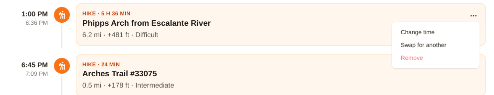
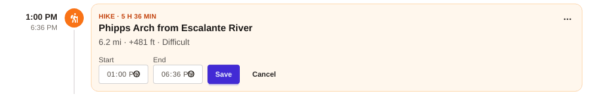
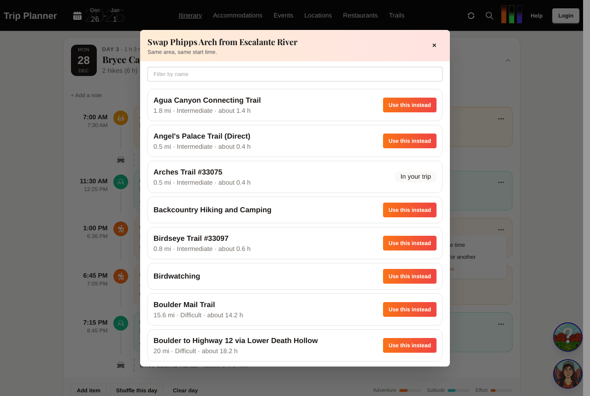
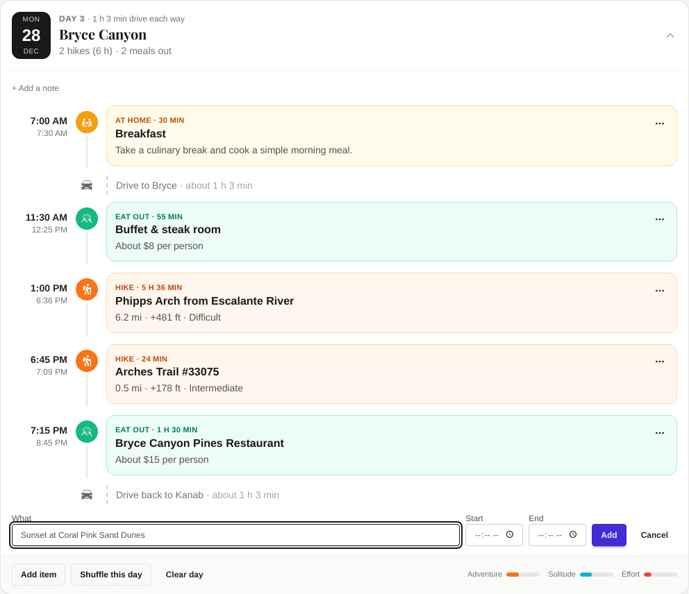

You can change anything on a trip you're allowed to edit. If you don't see the **⋯** menus or the buttons at the bottom of each day, you're looking at a read-only copy. See [Sharing and who can edit](/docs/itinerary/sharing/).

Every change is saved straight away. There's no save button for the whole trip.

## Change an item's time

1. Select **⋯** on the item.
2. Choose **Change time**.
3. Set a new **Start** and **End**, and choose **Save**.

The item moves to its new place on the timeline. Trip Planner doesn't stop you from overlapping other items, so check the rest of the day afterwards.

## Swap an item for something similar

1. Select **⋯** on a hike, meal, event or place.
2. Choose **Swap for another**.
3. Pick a replacement from the list and choose **Use this instead**.

The list shows things of the same kind in the same area. Type in **Filter by name** to narrow it down. Anything already on your trip is marked **In your trip**, and the item you're replacing is marked **Current**. The replacement keeps the same start time, and its end time is worked out from how long the new one usually takes.

## Remove an item

Select **⋯** and choose **Remove**. The item is deleted right away.

## Add your own item

1. At the bottom of the day, choose **Add item**.
2. Describe it in **What**, for example "Ice cream in town".
3. Optionally set a **Start** and **End** time.
4. Choose **Add**.

Your item appears on the timeline as a **Note**.

### Add a trail, restaurant, event or place

From the [browse pages](/docs/explore/trails/) or search, choose **Add to itinerary** on anything and pick a day. Days in the same area are marked **nearby**. It's added at a typical time for its kind (9:00 AM for a hike, noon for a restaurant, 10:00 AM for a place, 6:00 PM for an event), and you can [change the time](#change-an-items-time) afterwards.

## Notes

Each day can have one note, shown in italics under its heading.

- Choose **+ Add a note**, type, then **Save note**.
- To change it, choose **Edit** next to the note.

Notes are a good place for reservations, permit numbers or packing reminders.

## Shuffle this day

**Shuffle this day** throws the day's plans away and builds it again from scratch, using the same area and your preferences. It won't pick anything already on your other days.

The day's note and any changes you made to it are lost.

## Clear day

**Clear day** removes everything from the day, including its note, leaving it free. Use **Add item** to fill it yourself, or **Shuffle this day** to have Trip Planner fill it again.

## Rename the trip

Select the pencil next to the trip's name in the summary, type a new name and choose **Save**.

## Start over

- **New itinerary** in the summary, or the circular arrows in the header, builds a whole new trip from your current preferences.
- Your old trip isn't deleted. If you saved it to your account, it's still in [My trips](/docs/accounts/my-trips/).
