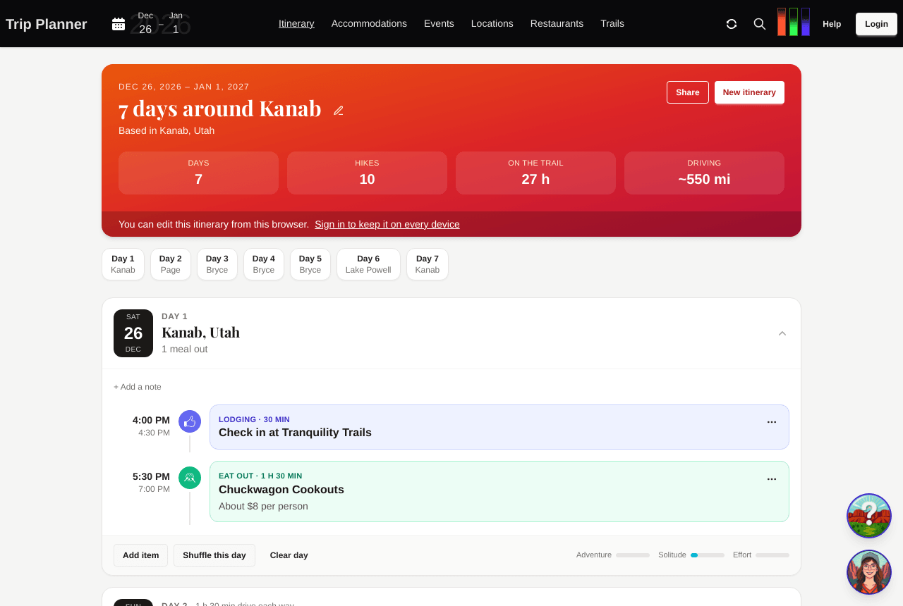
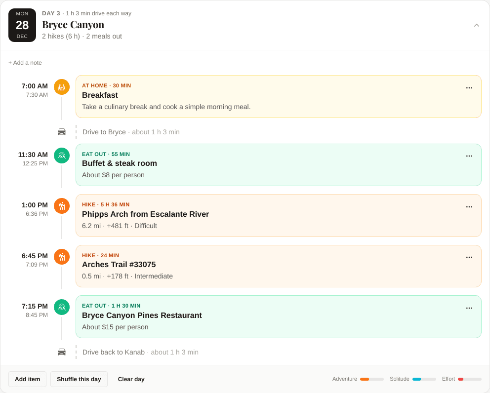
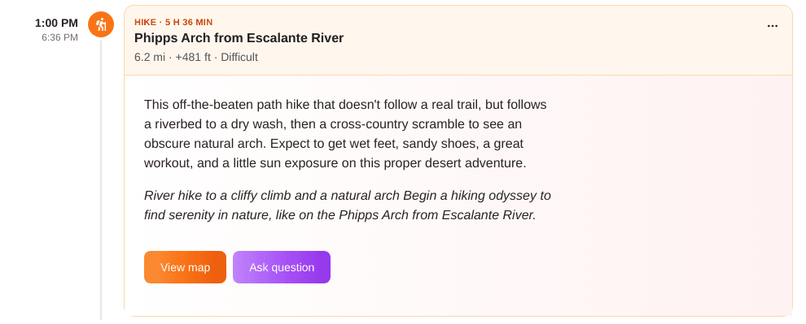

## The trip summary

The coloured panel at the top shows:

- **Dates** and the trip's **name**. New trips are called something like "7 days around Kanab". Select the pencil to rename yours.
- Where you're **based**.
- **Days**, **Hikes**, **On the trail** (total time hiking) and **Driving** (approximate miles for the whole trip).
- **Share** copies the trip's link. See [Sharing and who can edit](/docs/itinerary/sharing/).
- **New itinerary** builds a fresh trip from your current preferences.
- A line telling you whether you can edit this trip, with a link to sign in or **Save to my account**.

Below the summary, a row of **day buttons** shows each day's number and area. Select one to jump to that day. The row stays at the top of the screen as you scroll.

## A day

Each day is a card. The heading shows:

- the **date**;
- the **day number** and, on day trips, the **drive** each way;
- the day's **area**;
- a short summary, such as "2 hikes (6 h 18 min) · 2 meals out";
- the **weather** forecast, once the date is close enough for a forecast (about a week ahead), on larger screens.

Select the arrow on the right of the heading to collapse or expand the day.

Under the heading is the day's **note**. Trip Planner sometimes writes one, and you can write your own (see [Editing a day](/docs/itinerary/editing/#notes)).

## The timeline

Each item on the timeline shows its **start time** in bold and its **end time** underneath, a coloured icon for what kind of thing it is, and a card with details.

| Label | Colour | What it is |
| --- | --- | --- |
| **Hike** | Orange | A trail, with its length, total climb and difficulty. The time shown is your estimated hiking time. |
| **Eat out** | Green | A restaurant meal, with the typical price per person. |
| **At home** | Amber | A meal where you're staying. |
| **Event** | Purple | A local event. |
| **Sightseeing** | Blue | A place to visit. |
| **Lodging** | Indigo | Checking in or out. |
| **Note** | Grey | A reminder, such as **Pack a lunch**, or something you added yourself. |

Grey **Drive** lines between items show when you're on the road, for example "Drive to Zion · about 49 min" and "Drive back to Kanab".

### More details

Select an item's name to expand it. Hikes and restaurants show a description, photos where available and buttons:

- **View map** shows the trail's route on a map.
- **Ask question** opens the [virtual assistant](/docs/explore/assistant/) about this trail.
- **Website** opens a restaurant's own site, when it has one.
- **View accommodations** on a check-in links to your lodging.

## Day stats

At the bottom of each day, three small bars show how the day measures up on **Adventure**, **Solitude** and **Effort**. They're the averages of everything on the day, so you can spot a day that's harder or busier than you'd like and [shuffle it](/docs/itinerary/editing/#shuffle-this-day).
