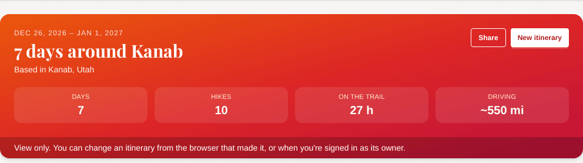

## Share a trip

Choose **Share** in the trip summary. The button changes to **Link copied**. Paste the link into a message or email.

Anyone with the link can **see** the trip. Only you can **change** it.

People you share with see the whole plan, can expand items and view trail maps, and see the message "View only. You can change an itinerary from the browser that made it, or when you're signed in as its owner." They don't see the **⋯** menus or the editing buttons.

:::caution
Treat the link like an address: anyone who has it can read your trip, including your dates. Don't post it publicly if that matters to you.
:::

## Who can change a trip

You can edit a trip in either of these cases.

### You made it in this browser

When you create a trip, this browser is given a private key for it and keeps it. You don't need an account. Come back in the same browser and you can still edit.

The key is lost if you:

- use a different browser, device or private window;
- clear your browser's site data or cookies for Trip Planner.

To avoid losing edit access, save the trip to an account.

### It's saved to your account

If you're signed in when you create a trip, it's saved to your account automatically. If you made it before signing in, choose **Save to my account** in the summary while signed in, from the browser that made it.

Once a trip is in your account you can edit it from any device where you're signed in, and it's listed in [My trips](/docs/accounts/my-trips/).

## Can two people edit the same trip?

There's no way to invite a co-editor yet. If you're planning together, one person makes the changes and everyone else follows along with the shared link, which always shows the latest version.
