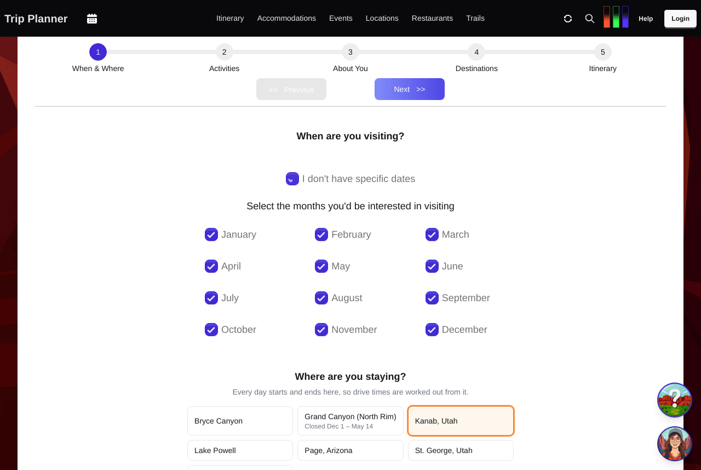
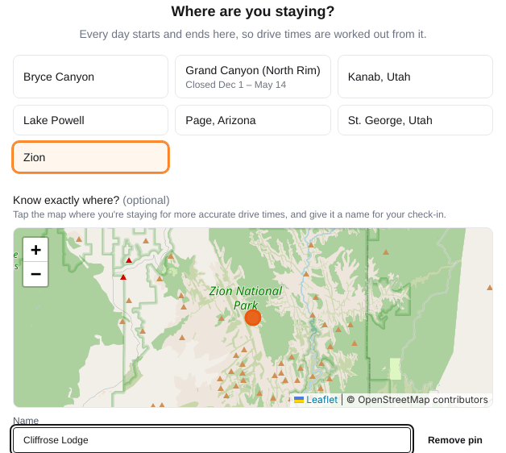
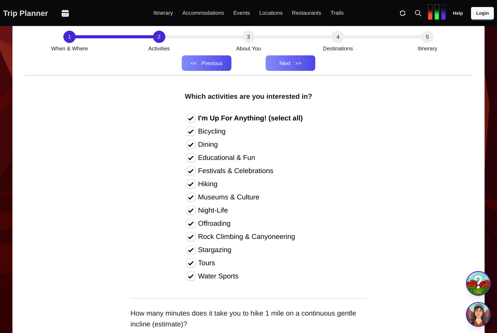
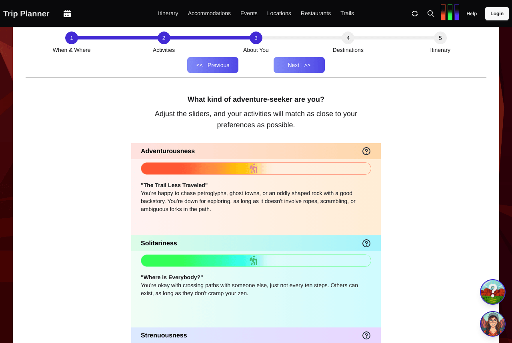
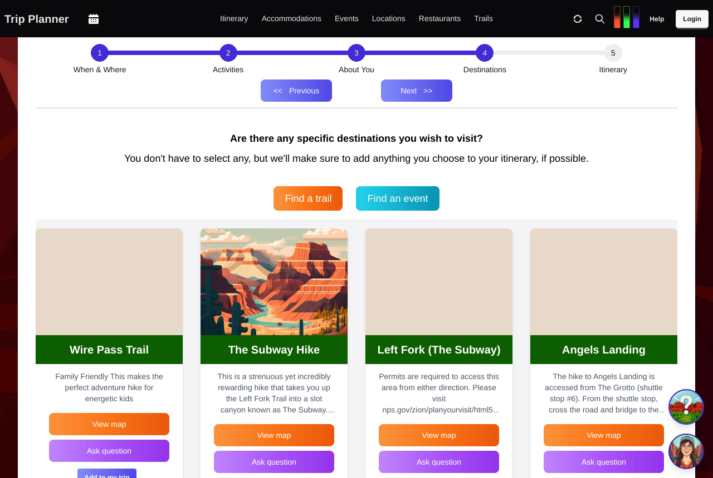

The questionnaire has five steps, shown along the top of the page: **When & Where**, **Activities**, **About You**, **Destinations** and **Itinerary**. Use **Previous** and **Next** to move between them. Nothing is final until you choose **Create itinerary**, and you can come back to change your answers at any time.

## When & Where

### Your dates

- **Choose Dates** opens a calendar. Pick your arrival day, then your departure day. The trip includes both.
- Not sure yet? Tick **I don't have specific dates** and select every month you'd consider. Trip Planner picks one of those months for you and plans a seven-day trip.

Your first day is an arrival day: you check in around 4:00 PM and go out for dinner. Your last day is a departure day: breakfast, then check-out at 10:00 AM. Everything else happens on the days in between, so a trip needs at least three days to include a full day of activities.

### Where you're staying

Under **Where are you staying?**, choose the area you'll stay in. Kanab is chosen to start with. Every day starts and ends there, so this decides how far each day's drives are.

If you know exactly where you're staying, tap that spot on the map under **Know exactly where?** and type its name, for example "Cliffrose Lodge". Your check-in then reads "Check in at Cliffrose Lodge", and drives are worked out from that spot instead of the middle of the area. To start again, choose **Remove pin**. Choosing a different area also removes the pin.

See [Where you stay](/docs/planning/areas/#where-you-stay) for how your choice changes the trip.

:::note[Seasons]
The Grand Canyon's North Rim is closed from December 1 to May 14. Trips in those months never send you there, and you can't stay there: if you pick dates in the closure, the North Rim can't be chosen as your base. See [Destinations and areas](/docs/planning/areas/).
:::

## Activities

Tick the kinds of things you'd enjoy, or **I'm Up For Anything!** to select them all.

- **Hiking**, **Bicycling**, **Offroading** and **Rock Climbing & Canyoneering** make room for trail days.
- **Educational & Fun**, **Festivals & Celebrations**, **Museums & Culture**, **Night-Life**, **Stargazing** and **Tours** let local events onto your days.
- **Dining** and **Water Sports** are listed too. Meals are always planned, whatever you tick.
- Leave all the trail activities off and no hikes are scheduled, unless you add a trail on the Destinations step. Your days then hold meals, events and anything on your wish list, with free time to fill as you like.

### Your hiking pace

If you tick hiking, you'll be asked how many minutes it takes you to hike one mile on a steady, gentle incline. Thirty minutes is a typical pace. Trip Planner uses your answer, along with each trail's length and climbing, to estimate how long every hike will take you and to fit the rest of the day around it.

Be honest rather than optimistic. Hike times include the extra time steep sections take and a little for getting tired over long distances, so a realistic pace gives you realistic days.

## About You

Three sliders describe the kind of trip you want:

- **Adventurousness**: from "I Came for the Gift Shop" to "Did I Just Discover a New Planet?"
- **Solitariness**: from "The More the Merrier" to "Unplug Me from Society".
- **Strenuousness**: from "If It Ain't Flat, I Ain't Doing That" to "I Didn't Know I Could Sweat There".

The label and description under each slider change as you move it, so you can see what each setting means. [Your preferences explained](/docs/planning/preferences/) covers exactly what each one changes.

## Destinations

If you already know you want to hike Angels Landing or catch a particular event, add it here. Choose **Find a trail** or **Find an event** to search, or use **Add to my trip** on any of the suggestions.

Anything you add goes on a wish list. Trip Planner puts wish-list items into your itinerary first, on a day you're in the right area, and plans the rest around them. This step is optional.

:::tip
You can add to the wish list from the browse pages too. When you don't have an itinerary you can change, **Add to itinerary** saves the item for the next one you create.
:::

## Itinerary

Choose **Create itinerary**. Building the plan usually takes a few seconds. When it's ready, it opens on the itinerary page.

You can build up to ten itineraries a minute. If you hit that limit, wait a moment and try again.
